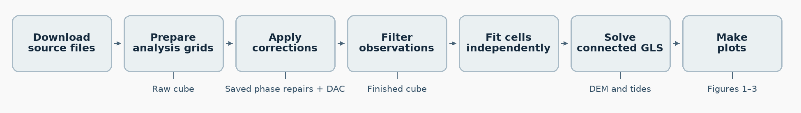

# Larsen C ice-shelf tides from SWOT

Ocean tides are among the largest sources of short-term vertical motion on
floating ice shelves. They can modulate ice flow and alter stresses that
affect shelf stability. Accounting for tidal motion is also important when
using satellite altimetry to study other changes in ice-shelf elevation.


We use Larsen C Ice Shelf to show how repeat 100 m SWOT High-Rate Raster
elevations can produce an up-to-date digital elevation model (DEM) and map
tides across the shelf. We estimate amplitudes and phases for four major
tidal constituents (M₂, S₂, K₁ and O₁) and compare them with the regional
tide model CATS2008-v2023. The comparison shows where SWOT resolves finer
spatial structure, particularly near the grounding zone.

This repository contains the Python code and data lists for the study.

## Paper figures

- [Figure 1](figures/figure1.png) compares the 100 m SWOT mean surface with REMA and ICESat-2. The SWOT and ICESat-2 elevations are referenced to the mean-tide geoid.
- [Figure 2](figures/figure2.png) compares SWOT and CATS2008-v2023 tidal amplitudes for M₂ and S₂, with a closer look at western Larsen C.
- [Figure 3](figures/figure3.png) compares CATS and SWOT tidal corrections along a repeat transect. Both passes contribute to the SWOT fit, so this comparison is in-sample.

## Recreate Figures 1–3

Unzip the prepared figure inputs in the repository root. The archive contains
the elevation grids, tide amplitudes, transect profiles and map backgrounds.
[Download the prepared figure inputs](https://github.com/RasmusArildsen/SWOT-IcyTides/releases/download/figure-inputs-v1/larsen-c-figure-inputs.zip)

Run these commands from the repository root with Python 3.12.

```sh
python -m pip install -r plots/requirements.txt
python -m plots.figure1
python -m plots.figure2
python -m plots.figure3
```

The scripts write PNGs and PDFs to `figures/reproduced/`.

## Rebuild with saved phase repairs

Start with the SWOT Raster tiles and ICESat-2 ATL06 files to rebuild the cubes,
fit the tides and make the figures. This workflow uses the saved phase repairs
derived from SWOT HR PIXC.



- [SWOT 100 m HR Raster files](file_lists/swot_raster.tsv)
- [SWOT HR PIXC file list for phase repair](file_lists/swot_pixc.tsv)
- [ICESat-2 ATL06 files](file_lists/icesat2_atl06.tsv)
- [Saved phase repairs](https://github.com/RasmusArildsen/SWOT-IcyTides/releases/download/figure-inputs-v1/larsen-c-phase-repairs.zip)
- [REMA, CATS, BedMachine, AVISO DAC and map backgrounds](Code/DATA.md)

Unzip the saved repairs into `inputs/phase_repairs/`. Copy the path template
and fill in `Code/input_paths.json`. Skip the download command if the
satellite files are already on disk.

```sh
python -m pip install -r Code/requirements.txt
cp Code/input_paths.example.json Code/input_paths.json
```

```sh
python Code/download_data.py
python Code/step01_prepare_grids.py
python Code/step02_apply_corrections.py
python Code/step03_filter_observations.py
python Code/step04_fit_independent_tides.py
python Code/step05_fit_connected_gls.py
python Code/step06_make_plots.py
```

The cubes are `work/raw_cube.h5` and `work/finished_cube.h5`. The fitted
elevation and tide maps are in `work/figure_products/`. Step 06 prepares the
figure inputs from these products, then calls the same three drawing
functions in `plots/` and writes the figures to `work/figures/`.

### Settings

The checked-in values reproduce the Larsen C analysis. The settings files
sit alongside the source lists and prepared geometry.

| Change | Settings |
| --- | --- |
| Study bounds, floating-ice seed and boundaries, inland margin | [study_area.json](Code/aux_files/study_area.json) |
| Grid extent, screening, tidal fit and CATS crop padding | [analysis.json](Code/aux_files/analysis.json) |
| Map bounds, ICESat-2 date window and transect display | [figure_settings.json](Code/aux_files/figure_settings.json) |

Use a new work folder when changing processing settings. For a changed study
footprint, set `domain_cells` in `analysis.json` to `null` to use the
computed cell count. A different footprint or transect needs matching
source coverage, saved repairs and Figure 3 sampling inputs.

[Processing methods](Code/METHODS.md)
